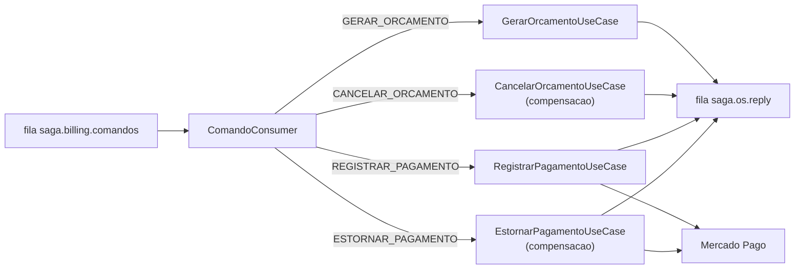
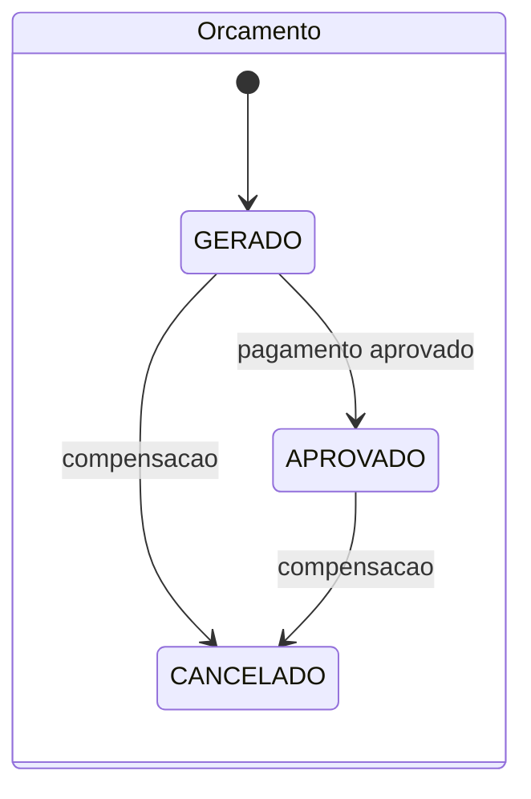
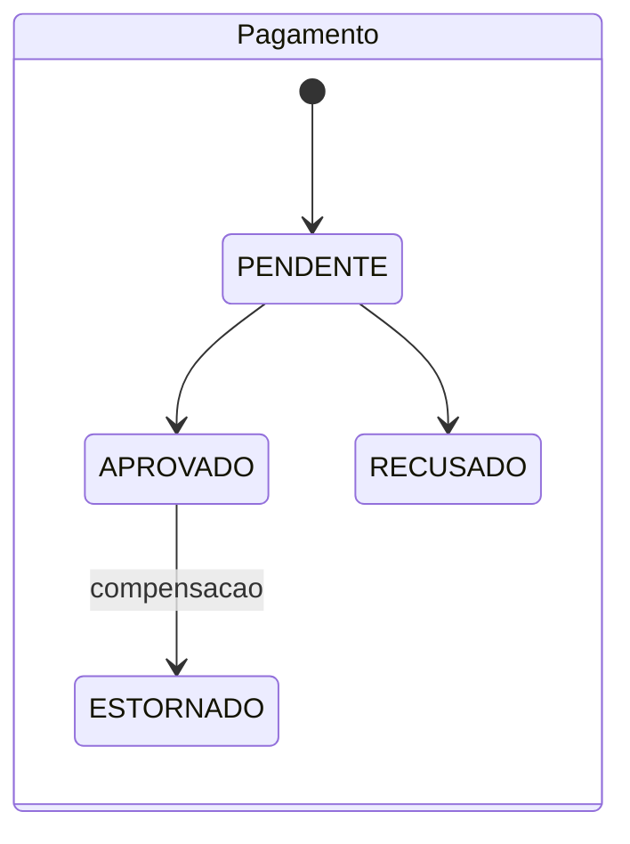
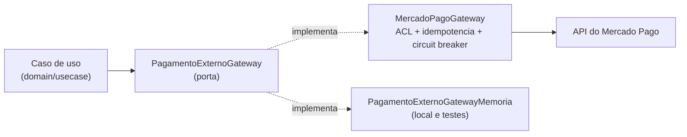

# Arquitetura do Billing Service

Documento específico deste participante. A visão do sistema distribuído, os
diagramas da Saga e os ADRs da Fase 4 estão no repositório do orquestrador:

- [Arquitetura geral da Fase 4](https://github.com/pyGits/fiap-tc-ms-os/blob/main/docs/arquitetura.md)
- [ADR-014 — divisão em três microsserviços](https://github.com/pyGits/fiap-tc-ms-os/blob/main/docs/adr/ADR-014-divisao-em-tres-microsservicos.md)
- [ADR-015 — Saga orquestrada](https://github.com/pyGits/fiap-tc-ms-os/blob/main/docs/adr/ADR-015-saga-orquestrada.md)
- [ADR-016 — RabbitMQ como broker](https://github.com/pyGits/fiap-tc-ms-os/blob/main/docs/adr/ADR-016-rabbitmq-como-broker.md)
- [ADR-017 — persistência poliglota](https://github.com/pyGits/fiap-tc-ms-os/blob/main/docs/adr/ADR-017-persistencia-poliglota.md)
- [ADR-018 — idempotência e dead letter](https://github.com/pyGits/fiap-tc-ms-os/blob/main/docs/adr/ADR-018-idempotencia-e-dead-letter.md)

---

## Os quatro comandos deste participante

Cada comando tem a sua compensação no mesmo serviço. Toda resposta vai para a
**mesma** fila de reply do orquestrador: este serviço não conhece o Execução nem
publica nada diretamente para ele.

## Respostas possíveis

| Comando | Sucesso | Falha |
| --- | --- | --- |
| `GERAR_ORCAMENTO` | `ORCAMENTO_GERADO` | `ORCAMENTO_FALHOU` |
| `CANCELAR_ORCAMENTO` | `ORCAMENTO_CANCELADO` | — (compensação nunca falha) |
| `REGISTRAR_PAGAMENTO` | `PAGAMENTO_REGISTRADO` | `PAGAMENTO_FALHOU` |
| `ESTORNAR_PAGAMENTO` | `PAGAMENTO_ESTORNADO` | — (compensação nunca falha) |

As compensações respondem sucesso mesmo quando não há nada a desfazer, ou quando
o provedor externo está indisponível (o estado é corrigido no domínio e a falha
de integração é registrada na telemetria). Uma compensação que falhasse deixaria
a Saga presa em `COMPENSANDO`.

## Ciclos de vida

## Isolamento do provedor externo

O caso de uso fala com a porta. Trocar o provedor é escrever outro adaptador —
nenhuma linha de regra de negócio muda. Em ambiente local e em homologação a
implementação em memória é a selecionada, e o provedor real nunca é contatado.
